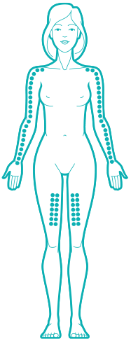

#### Gel

O gel de estradiol mais comum encontrado na maioria das farmácias do Brasil é o
- Oestrogel

Dose:
- Dose inicial padrão: 3mg de estradiol por dia (Podendo ser ajustado até 6mg) + Bloqueador de Testosterona.

Consulte a embalagem e saiba quantos mg de estradiol cada pump contém. Numa calculadora, divida:

Dose diária de estradiol / Estradiol por pump

Se a embalagem indicar 0.6mg de estradiol por pump e você começar com uma dose de 3mg por dia, faça 3/0.6 = 5.

No caso de uma dose de 3mg por dia e uma embalagem que solta 0.6mg por pump, você usará 5 pumps por dia. Aplique sempre no mesmo horário, todos os dias.

Faça as contas de acordo com o que a embalagem que você comprou e ajuste.
Comece com 3mg por dia. Faça exames de sangue após 3 meses de uso e faça o reajuste de dose se necessário.

Consulte os exames de sangue que você deve fazer se escolher a TH pela via transdermal (Gel)

##### Aplicação do gel

Assim como na imagem, aplique gel na parte externa dos braços ou na parte interna superior das coxas.

Se for mais cômodo, você pode espalhar o gel em dois ou mais locais de aplicação diferentes quando for usar.
:::note
**Importante**: Você deve **SEMPRE** tomar banho antes de aplicar o gel e, se possível, depile a(s) área(s) de aplicação. Sujeira, impurezas, suor e pelos podem diminuir a absorção do gel pela sua pele.
:::